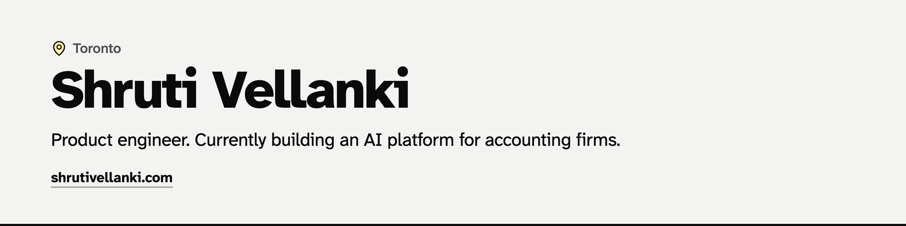

<!-- Paste at the top of your GitHub profile README (github.com/ShrutiVellanki/ShrutiVellanki).
     GitHub swaps between the light and dark banner to match the viewer's theme. -->
<a href="https://www.shrutivellanki.com">
  <picture>
    <source media="(prefers-color-scheme: dark)" srcset="https://raw.githubusercontent.com/ShrutiVellanki/lavender-portfolio/main/brand/github-banner-dark.png">
    
  </picture>
</a>
